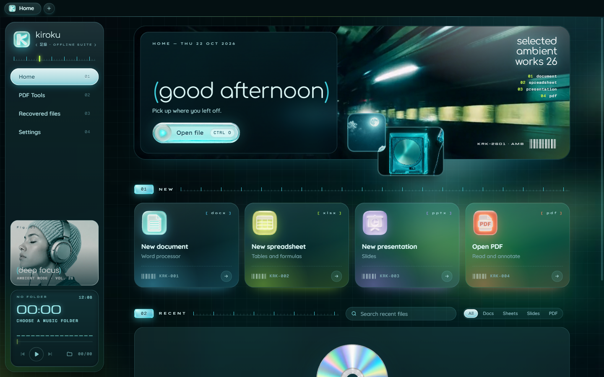

# Kiroku 記録

An offline office suite for Windows: documents, spreadsheets, presentations and PDF, in a
Y2K "soft club" skin of frosted aqua glass and clear plastic. Nothing you open leaves your PC.




## Features

- Opens and saves Word, Excel and PowerPoint files (docx, xlsx, pptx, plus doc, xls, ppt, odt, ods,
  odp, rtf, txt, csv), and views and annotates PDF.
- Tabs, with tab colours, drag-out windows and drag-back docking.
- PDF tools: merge, split, extract pages, delete pages, rotate, images to PDF.
- Recent files and folders with pinning, a type filter and file-name search across Documents,
  Desktop and Downloads. The recent list can be stored encrypted.
- Automatic recovery copies, password-protected files and Save As to other formats.
- A small music player in the sidebar that plays a folder you pick, with media-key support.
- Light and dark themes; the editors come in 12 languages.
- Fully offline: the app only talks to itself on 127.0.0.1.

## Install

Download `Kiroku Setup x.y.z.exe` from [Releases](../../releases) and run it. It installs for your
user only, no admin rights needed. The installer isn't code-signed yet, so Windows SmartScreen may
warn you: click **More info**, then **Run anyway**.

To open files with Kiroku by default: Settings, then **Make Kiroku the default**.

## Build from source

You need Windows 10 or 11, [Git](https://git-scm.com/) (with Git Bash), [Node.js](https://nodejs.org/) 24+
and pnpm 11 (`corepack enable`).

```bash
git clone https://github.com/HermesArcher/kiroku.git kiroku
cd kiroku
bash scripts/engine.sh setup   # fetches the editor engine, applies engine.patch, builds it (a few GB, takes a while)
cd app
npm start                      # run Kiroku
npm test                       # unit tests
npx playwright test            # end-to-end tests: they launch the real app
npm run dist                   # installer in app/release/
```

## How it's put together

- `app/` is the Electron desktop shell: `main/` (windows, tabs, files, PDF tools), `preload/` and
  `renderer/` (the home screen, sidebar and player).
- The editors run from a separate engine: [ranuts/document](https://github.com/ranuts/document), the
  ONLYOFFICE editors compiled to run in the browser. It isn't stored in this repo. `scripts/engine.sh`
  downloads it at a pinned commit and applies Kiroku's changes from `engine.patch`. After changing the
  engine, run `bash scripts/engine.sh patch` to update the patch.
- [docs/ARCHITECTURE.md](docs/ARCHITECTURE.md) describes how the shell and the editors talk to each other.

## License

Kiroku is free software under the [GNU AGPL v3.0](LICENSE). Third-party notices are in
[THIRD-PARTY.md](THIRD-PARTY.md). ONLYOFFICE is a trademark of Ascensio System SIA; Kiroku is not
affiliated with them.
